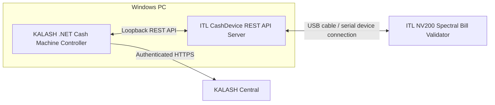

# KALASH

An donation webApp that connect devotees and temple in confortable way. Devotees can donate cashes to temple by crypto remotely and also by notes using ATMs that are placed in temples.


### How it's Made

KALASH bridges a physical bill acceptor and a mobile, wallet-based donation
experience. Its defining breakthrough is the NV200 Spectral: unlike most bill
validators, it can connect to a Windows PC over USB and be controlled through
the manufacturer's REST API. That unusually direct hardware-to-software path
is what made this project possible.

#### NV200 bill validator

The manufacturer's ITL CashDevice REST API Server exposes the USB-connected
validator to software on the Windows PC. KALASH's .NET Windows Controller
starts and communicates with that server over loopback; the server in turn
talks to the validator. The Controller reports device readiness and cash-session
events to KALASH Central over authenticated HTTPS. This keeps the vendor-specific
device protocol behind a local API and gives the application a defined boundary
for hardware status and operations.



Cash intake is treated as a stateful, reconciled operation rather than a
button that simply adds an amount. For a cash-enabled session, the Controller
reports note events in order; Central matches them to the active ATM session.
After the user finishes or the acceptance window closes, the device is stopped
and its inventory and counters are reconciled before the cash is confirmed.
Uncertain device outcomes are not treated as successful donations or blindly
retried. Cash acceptance is separately gated by Central and Controller
readiness; the current M5a onsite flow is Crypto-only, as described below.
See the [Cash Machine Controller guide](CashMachine/CashMachineController/README.md)
for the local process and safety boundaries.

#### MetaMask mobile deep link and in-app browser

Mobile wallet flows can be awkward when the dapp and signer live in separate
apps: a user may have to create or import a second wallet for an app, or switch
back and forth between a dapp browser and a wallet to approve requests. KALASH
uses MetaMask's DApp deep link to open its canonical HTTPS temple page in
MetaMask's built-in browser, alongside the user's existing wallet.

At an ATM, choosing Crypto creates a short-lived reception in Central and
displays a QR code containing the MetaMask link to that temple page. The phone
can scan it with its external QR reader; MetaMask opens the KALASH page with an
opaque reference to the pending reception. The phone and ATM both continue
through Central, so the phone does not connect directly to the ATM or Windows
Controller. An external mobile browser can also offer an **Open in MetaMask**
link.

To build the link, start with the canonical HTTPS page for the temple. For an
active ATM reception, add its opaque reference as the `visit` query parameter:

```ts
const target = new URL(`/temples/${templeId}`, canonicalOrigin);
target.searchParams.set('visit', reference);
const deepLink =
  `https://link.metamask.io/dapp/${target.href.slice('https://'.length)}`;
```

For example, `https://<canonical-host>/temples/temple-01?visit=<reference>`
becomes
`https://link.metamask.io/dapp/<canonical-host>/temples/temple-01?visit=<reference>`.
Build the target URL first, validate that it uses the configured HTTPS origin
and an allowed temple path, then put its host, path and query after
`https://link.metamask.io/dapp/`. Do not URL-encode the entire target a second
time: that would encode its separators and prevent MetaMask from opening the
intended page. A normal temple link can omit the `visit` parameter. KALASH's
implementation is in [`src/atm.ts`](src/atm.ts), with URL-preservation and
rejection cases in [`tests/atm.test.ts`](tests/atm.test.ts).

The QR is an entry point, not permission to transact. Opening it does not
connect a wallet, join the reception, start cash acceptance, or send a payment.
The reference is for finding the pending reception, not a credential or payment
authorization; do not put wallet keys, session credentials or tokens in the
link. The user reviews the temple and request, explicitly joins with a verified
wallet, and confirms each wallet action. For Crypto donations, any needed token
approval and the donation itself are distinct requests. MetaMask remains the
signer throughout; KALASH does not receive or store the user's private key.
