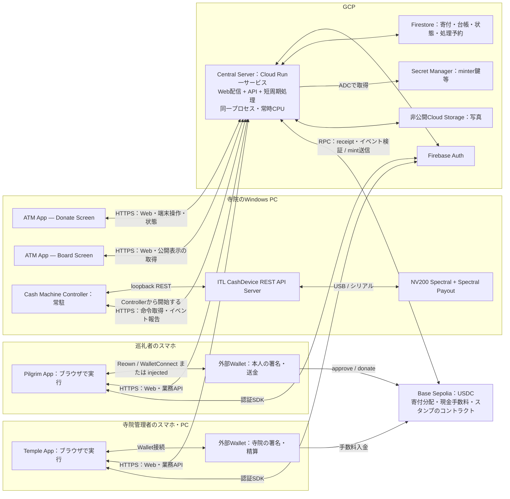

# KALASH input specification

Implement and verify KALASH against real services, Android and cash hardware.
The approximately five-hour allocation is a target, not permission to claim
unverified results. All ETH/USDC operations below use Base Sepolia (84532)
test tokens only. Cash is real hardware and retains all safety requirements.
The following input was preserved from the user attachment at project start.
The UX sections below incorporate the user's 2026-11-06 decisions in
[the MetaMask/ATM journey](issue-penetrator/kalash-metamask-browser-journey.md).
Photo withdrawal follow-up is deferred by the user; it is not a gate for M3.
Existing owner withdrawal remains available. Deferred work is tracked in TASKS.

2026-11-07 owner update: keep Cash configuration ON with a resident Controller,
while retaining signed consent, fresh hardware readiness, finite sessions,
limits and reconciliation locks. Payout remains exclusive with reception.
For the test/demo, temple-01's explicitly assigned wallet administrator and fee
payer is `0x7B79c37Bb80cc76Fe6b758c7140228FEcc7e2A2e`; donation recipients and
existing history do not change. Implement M4 next; actual fee payment and
physical dispensing require separate amount-specific confirmation.
The owner subsequently removed software/operator bezel-empty confirmation
from the payout UX for this attended hackathon/demo. Do not fabricate an empty
bezel reading. Actual held-note events, device faults, transaction completion,
inventory/counter reconciliation and no-blind-retry behavior remain in effect.
Instruction 7 timing recommendations are being applied: human QR/consent/cash
windows 240 seconds, observation freshness and cross-host skew 30 seconds,
device enable/close waits 20 seconds, initialization 30 seconds, ITL status
HTTP 4 seconds and other HTTP 10 seconds, payout completion 180 seconds.
Owned event polling stays at 200ms and ESCROW decisions remain within 2 seconds.
Deadline stops new notes while in-flight notes are resolved; local closeDetail
distinguishes causes without adding Central wire reasons.

2026-11-07 Interim owner override: keep signed QR consent and resident Cash ON,
but historical ledger/inventory mismatches alone must not prevent the next
intake. Preserve discrepant evidence; do not fabricate reconciled donations.
Recognized ledger cash is settled at the existing 3% USDC fee. After that fee
is canonically paid, a fresh administrator approval may dispense all actual
Payout-compartment notes even when their value differs from credited ledger
cash. Cashbox notes are physically unavailable and excluded. Device faults,
unresolved physical commands/escrow and unknown payout no-retry protections
remain. This explicit Interim mode is distinct from the strict production
policy; historical records and donation recipients remain unchanged.

2026-11-07 owner capacity override: Interim removes the software machine-wide
INR1000/10-note limits and the Central cumulative INR1000/10-note demo budget
gates. Continue recording full inventories and cumulative budget evidence.
Strict mode retains those limits. Signed consent, INR400 per reception,
240-second windows, actual device faults and no-blind-retry remain unchanged.

```
### 最初の操作に適用する短いルールとチェック

プロジェクト直下の`AGENTS.md`は約20行以内の入口とし、次の項目だけを置く。SPECは入力仕様、SDDは具体化した設計、TASKSは現在の進捗と役割を分ける。同じ仕様・進捗をAGENTSへコピーし続けない。利用ツールによるAGENTSの自動読込を仮定せず、初回・再開時に明示的に読む。

- 初回は`docs/SPEC.md`を読み、再開時はTASKS冒頭・担当行とSPEC／SDDの関連節を読む。
- 現在のゴールへ集中し、担当ファイルを守る。全ゴールはSPECにあり、人がM1・M2を順番に再投入する必要はない。
- 最初の取得前にpnpm・公開168時間制約・導入スクリプト禁止を確認する。実コマンドはSPEC §3.3に従う。
- 約10分ごとと節目にSDD／TASKSを照合し、Gitへ保存する。未確認を完了にしない。
- 外部障害は影響するタスクだけに記録し、独立作業・必要な準備を進める。
- 終了／引き継ぎ時は、対象版・証拠・未完了・人の操作・次の一手をTASKSへ残す。

導入前チェックは、追加依存なしで動く小さな`node scripts/check-policy.mjs`等として開始後に作る。`packageManager`と実pnpm版、Node版、§3.3の設定と有効値、npm／Yarn lockfileの混入を照合し、違反なら非0で終了する。lockfile作成後は公開日時検証結果とlockfileハッシュも確認する。初回のlockfile未作成と、既存lockfileの検証漏れは区別する。このチェックを明示的な導入手順・ビルド／テストの入口・CI／配備前でも使い、禁止されているinstallフックへ実装しない。専用の管理サービスは作らない。

現在のゴールで必須としたサーバー／APIの認可・金額・寄付確定・冪等性等の検証は、対象テスト0件・全件skipを成功にしない。`passWithNoTests`等で必須検証を通過扱いにせず、未実装／接続待ちをTASKSに残す。全パッケージに同じテスト数を課さず、ビルド成功・画面表示・空のテスト成功をAPI確認の代わりにしない。

### 障害はタスク単位で扱う

TASKSへ `影響するGoal／タスク・観測した事実・次の診断・必要な人の操作・再開条件` を記録する。後続の実機未準備を理由にM1を止めず、反対に模擬確認で未接続をverifiedにしない。

| 観測した問題 | 切り分けと、その間に進めること |
|---|---|
| GCP projectが見えない | project ID・選択アカウント・CLI認証・ADC・IAMを分けて確認。実クラウド接続は未完了とし、現在のゴールのAPI契約・入力検証・UI接続準備を進める。ローカル試験を実Auth／DB接続の代わりに数えない |
| ITL RESTが401 | 認証前の保護APIへの401と、正規Authenticate後のBearerでも失敗する401を区別。origin・資格情報の取得元・token期限を確認し、秘密は出力しない。機器確認はM3／M4の障害として記録し、M1のリモート寄付を継続する |
| ADBが利用不可 | コマンド有無・USB・serial・unauthorized／offlineを区別して必要操作を依頼。自動E2E・PCブラウザで確認できる箇所を進め、実スマホ確認は未実施として残す |
| Wallet・資金・Reown設定待ち | 作成した宛先・chain・必要額、実オリジンと設定箇所をまとめて提示。待つ間は認証・入力検証・保存・送信前確認の独立作業を進める。未送金・未接続を成功扱いしない |
| OS／CPUとツールが非対応 | 最小の起動・コンパイル・ローカル試験で確認し、下記の対応ホストへ移す。同じ非対応環境でフレームワークを次々に作り直さない |

現在のゴールの独立作業と先行準備を選び、後続機能の未完了を増やさない。人の操作だけが残った場合の例外は下記の立ち会い待ち条件に従う。実行可能な独立作業が尽きたら、必要な一操作・対象・再開条件と再開用の短文を提示して待つ。空のポーリングでターンを延ばさず、存在しない自動再開機能を約束しない。応答待ちを継続できる機能があれば利用し、セッションが終了した場合も次回はSPECを再投入せずTASKSから再開できる状態を残す。

### ゴールと時間配分

時間は配分目標であり、未確認を完了にする期限ではない。外部権限・機器・人の操作が必要な時点で利用でき、開始後に作成するWalletへの資金投入が間に合うことを5時間の前提とする。

| 経過時間の目安 | チーム全体で完成させるゴール | 終了条件 |
|---|---|---|
| 0〜15分 | 起動・接続診断・短いSDD・資金依頼 | 実行環境、不足、担当、次の一操作が明確 |
| 15〜100分 M1 | リモート寄付・探索・Collection | 最初の一本をローカルで実接続し、M1内でCloud Runへ配備（外部認証等の確認は§3に従い早期配備可）。同じ経路・実MetaMask・再読込を確認。10寺院・寄付者のポイント集計・二つのスタンプ帳を接続 |
| 100〜130分 M2 | 写真・ボード | 撮影／画像選択→プレビュー→同意→公開→取り下げが実保存で動き、寄付者のポイントに応じた写真サイズが一致 |
| 130〜195分 M3 | 現地紙幣寄付 | QR紐付け→実紙幣収納→受付終了・台帳照合→参拝スタンプ。端末の写真導線も接続 |
| 195〜240分 M4 | 手数料精算・払い出し | 実入金確認→管理者承認→実機全量払い出し→在高照合 |
| 240〜270分 M5 | 現地Crypto寄付 | M1の送金処理をATMのQRへ接続し、スマホ・ATMの結果と参拝スタンプが一致 |
| 270〜300分 | 通し確認・外観・起動手順 | §10の全経路を確認し、操作URL・実結果・未検証範囲を提出 |

- 一度に進めるゴールは一つ。並列化はそのゴールを通すための仕事と、権限・資金・機器の先行準備に限定する。M1〜M5を無断で削らない。
- 機器が未接続の場合は、本人の優先順位により`M5a 現地Crypto受付・寄付（Cashは無効）→ M3 現地現金`の順にする。M5a完了は現金受付・M4払い出しの完了を意味しない。NV200接続後にCashを別ゴールとして実装する。
- 統合担当を一人置き、必要な独立作業の分だけ担当を増やす。最大10 Agentまで利用可だが人数・役割は固定しない。同じファイルの編集、実機操作、デプロイの担当はそれぞれ一人にする。統合担当は完了報告を実結果と照合し、次の作業を割り当て、人の「続けて」を待たず進行する。人への操作依頼も統合担当に集約する。
- 全員が共有する進捗の正本は下記の`docs/TASKS.md`。機能ごとの未統合成果を積み上げない。
- 修正→同じ失敗操作を再実行→画像と保存結果を確認する。15分新しい証拠が出なければ仮説・再現手順・関連IDをまとめて救援へ切り替える。同じ資料の再読、盲目的再試行、無関係な全テストを繰り返さない。
- コード・接続・自動確認・ADB確認が済み、人の署名・紙幣操作だけが残る場合は「立ち会い待ち」と記録し、未確認部分に依存しない作業を一つ進めてよい。バグや接続不備をこの例外で先送りしない。
- デザインは実装Agentに任せる。少数の色・文字・余白・カード・ボタンを製品内で共通化し、独立した見本帳アプリや汎用デザインシステムを先に作らない。読みやすさ、確認・同意・エラー導線は各ゴール内、装飾は最後に整える。
- Fusionを使う場合の運用目安：Standardを通常の実装・操作・修正に、Highを金銭・認可・競合の局所レビューや難しい障害に使う。Maxは深い分析が必要な限定課題だけ。自動で設定変更できるとは仮定せず、変更できない場合も作業を続ける。モデル選択は完成・速度の保証ではない。

### 開発中のSDD・タスクリストと10分チェックポイント

開始時の入力はこのMD一枚。保存したSPECと短いAGENTSを入口とし、日々の設計・進捗は次の2ファイルだけで管理する。統合担当が作成・更新責任を持つ。各担当は担当タスクの差分・証拠・障害・次の一手を統合担当へ返し、同じ文書を同時編集しない。最初の製品実装より前に、保存したSPEC・短いAGENTS・SDD／TASKSの骨子を初回コミットとしてPushする。初回のPushが失敗した場合も、下記の未送信記録と継続手順を適用する。以降も設計判断・実装差分・検証の対応がGit履歴から追えるようにし、完成後にまとめて履歴を作らない。

| ファイル | 持たせる内容 |
|---|---|
| `docs/SDD.md` | 現在有効な実装設計。構成図、責務、状態遷移、ID・金額単位、API要求／応答、認可、ABI・イベント、永続化・冪等性、設定名・起動／検証コマンド。現在のゴールに必要な契約から具体化し、本MDの全文や議論を転載しない |
| `docs/TASKS.md` | 進捗の唯一の正本。冒頭約30行に現在ゴール・成功条件・稼働版／URL・対象chain・最初の障害・次の一操作・人への未完了依頼。続いてM1〜M5の状態とタスク表、最新チェックポイントを置く。完了・失敗の証拠は対象ID・結果・コードcommit・ログ／画像の場所で参照する |

タスク表の列は `ID / Goal / 担当・編集範囲 / 依存タスク / 状態 / 完了条件 / 証拠・次の一手`。状態は `todo / doing / blocked / human-wait / verified`。タスクは定めた完了条件と証拠でverifiedにする。ゴールは実処理・保存・画面反映まで確認し、コード作成やコミットだけでverifiedにしない。後続ゴールは粗い行だけ置き、現在のゴールの必要作業を小分けする。同じ担当が複数の未統合タスクを抱え込まない。

**約10分ごと、およびゴール切替・契約変更・配備・障害の変化・担当交代／コンテキスト更新の前には、次のチェックポイントを必ず残す。**

1. 統合担当が各担当の差分と、Git・実稼働版・直近の検証結果を照合し、TASKSの現在状態を更新する。SDDは契約差分だけ更新し、変更がなければ「SDD照合・設計差分なし」と記録する。文書更新のために設計を作り直さない。
2. TASKSの最新チェックポイントに `実時刻（UTC）・開始からの経過分 / 対象タスクID / 参照SDD節と設計差分または差分なし / 変更ファイル・実装commit（今回のcommitならその旨） / 試した操作と結果・未検証範囲 / 障害・人待ち / 次の一操作` を簡潔に残す。稼働版と作業中の版は区別する。秘密・認証トークン・短命QR・個人写真・生ログ全文は貼らない。
3. **統合担当が各チェックポイントでCommit＆Pushする。** 変更対象・ステージ差分・秘密混入を確認し、文書と担当範囲の保存可能な変更を小さくコミットする。メッセージにGoal／タスクIDと実際の変更を含め、未検証コードは未検証と明記する。`git add .`で他担当の編集を無差別に取り込まず、同じ作業ツリーのGit書込みは統合担当へ一本化する。ファイルの保存境界だけ担当と合わせ、全員の作業を停止させない。

Pushは終了コードと共有リモートの対象ブランチへの反映を確認し、ローカルコミットだけで共有済みと報告しない。通信・権限等で失敗したらローカルコミットを保持し、未Pushのcommit・理由・次の再試行条件をTASKSへ記録して独立作業を続ける。次のチェックポイントまたは復旧時に未送信分をPushし、連打・履歴の強制上書き・他担当の編集を失うresetはしない。今回自身のcommitハッシュやPush成功を同じcommit内へ書き戻すためのamendは行わず、共有状況は次の更新で記録する。ゴール完了・担当交代・最終提出時には未送信分を確認し、共有できていなければ明示する。

記録コミットと全体検証・配備は分離する。10分ごとのPushを毎回の全E2EやCloud Run再配備のトリガーにせず、必要な変更箇所の検証とゴール節目の配備は維持する。CIの起動条件を確認し、必要なら作業ブランチへの記録Pushと明示的な配備操作を分ける。記録のためだけの空コミット、架空の設計変更、未検証を成功へ変更する操作は行わない。作業中はSDDの判断やTASKSの結果を差分で記入しておき、チェックポイントで新たに長文を作文しない。

記録更新は1分程度を目安に差分だけ行い、全員の作業や紙幣監視を停止させず、10分のタイマー待ち・定期的な全ビルド／全E2Eを作らない。長い外部処理は非同期実行・短い状態確認を使い、機器処理等で記録が遅れた場合は理由と実時刻を安全な区切りで残す。日時や成果を遡って捏造しない。最新状態は文書に、過去のチェックポイントと設計差分はGit履歴に保持し、履歴の削除・squashで証跡を失わない。別のPLAN・HANDOFF・Agent別進捗文書へ同じ情報を転記しない。

### コンテキストを小さく保つ再開方法

- TASKSは現在状態と最新チェックポイントへ更新し、長い日記を追記し続けない。完了タスクはID・結果・証拠への参照を短く残す。詳細ログ・スクショはファイルへ保存し、必要な失敗箇所だけ読む。SDDは現行契約を保ち、廃止案や調査全文は読み込み対象にしない。
- 担当へ渡すのは `タスクID・ゴール・完了条件・編集範囲・必要なSDD節・稼働版・次の確認`。全会話・全仕様・他担当のログを毎回渡さず、初回に仕様を理解した後は関連箇所と差分を読む。統合担当も担当報告は結果・根拠・障害・次の一手に絞って受け取る。
- ゴール切替時や、同じ調査の繰返し・対象版の取り違えなどが出たら、上記チェックポイントを保存して短い引き継ぎへ切り替える。環境が対応する場合にコンテキストを圧縮／新しいセッションへ移し、定期的な強制リセットはしない。未コミット編集・所有者・進行中の送金／現金操作は必ず引き継ぐ。
- 再開は `TASKS冒頭と担当行 → SDDの該当節 → Git状態・直近差分 → 必要なAPI／DB／チェーン／機器状態` の順。全履歴を読み直さない。記録のtxHash・donationId・cashSessionId・payoutId・commandIdを照合し、再開を理由に送金・mint・払い出しを最初から実行しない。会話の切替とサービス／Controller再起動を混同しない。

## 2. 人の環境準備と開始後の操作

人が用意するのはアクセスと機器。アプリ、コントラクト、初期データはAgentが開始後に作る。秘密の値をチャットへ貼らせない。

| 人が行う準備 | Agentが開始時に確認・実行すること |
|---|---|
| 空の作業場所・Git保存先、Windowsでコマンド実行できるAgent、チェーン試験・ビルド用の対応Linux環境 | Web/APIをローカル起動。Windowsとクラウドで同じコミットを使う。WindowsのDocker Desktopは必須にしない |
| GCP project・課金・リージョン、必要な作成／配備権限 | `gcloud projects describe <id>`、有効APIを確認。Run・Artifact Registry・ビルド・Secret Manager・Firestore・Auth・Storage・IAMを必要範囲で設定。権限不足は操作と必要権限を一括提示 |
| Firebaseを同じGCP projectで利用可能にし、Google認証とEmail/Passwordの設定権限、Firestoreロケーションを用意 | Firebase・DB・非公開バケットを準備。管理者UIDと寺院所属を限定bootstrapで登録。CLI認証とADCは別に確認 |
| Reown project ID、localhostと公開URLの許可設定ができること | 実オリジンをmetadata・許可ドメイン・Firebase承認済みドメインへ反映。独自ドメインは必須でない |
| GCP・Firebase・Reown・依存取得先・Base RPCへ通信可能 | RPCのchainIdを照合。資格情報付きURLを公開しない |
| Windowsの.NET 10 SDK、メーカーDLL用ランタイム、ITL公式配布物・資料・資格情報の安全な保存先 | `dotnet --info`、実パス、OS/CPU、REST版、COM・firmware・datasetを確認。配布物をGitへ入れない |
| NV200 Spectral＋Spectral Payoutへ電源・USB、VMならUSB割当、100/200 INR紙幣 | COM占有ツールを閉じる。開始在高を読む。人の立ち会いで§8の一枚収納・回収を行う |
| 操作画面＋Board画面、カメラ、ブラウザ権限操作 | 表示先・向き・カメラ実映像を確認 |
| Android＋USBデータケーブル、Chrome・MetaMask。USBデバッグのPC許可とロック解除 | `adb devices -l`のdevice状態、対象serial、PC側Agentの画像閲覧機能を確認 |
| Base SepoliaのテストETH・CircleテストUSDCを送金できるWalletと、署名・指紋認証・紙幣投入回収の立ち会い | 役割別の公開アドレス・必要額を提示し、人がMetaMaskで送金。オンチェーン残高を確認して再開 |

### 実行ホストを先に決める

WindowsはController・ITL REST・USB機器・ADB操作に使う。コントラクトのコンパイル・ローカルチェーン試験・Cloud Run用ビルドは、採用ツールの対応を確認したLinux環境を優先する。特にWindows ARM64ではHardhat等のnative部品の対応を仮定せず、依存制約を保った最小試験を先に通す。対応Linux x64等を使える場合はそこで進め、代替ホストが必要なら早期に具体的な準備を依頼する。Windows用とLinux用のコードを別製品として作らず、同じコミット・ABIを共有する。

Web／APIの開発ホスト、Windows Controllerからの接続URL、Androidから開くURLをSDDへ記録する。別ホストの`localhost`は同じ接続先ではなく、USB接続PCの`adb reverse`だけで別ホストへは届かない。利用可能な許可済み経路を確認し、公開HTTPSが必要ならM1でCloud Runへ早期配備する。接続のためにITL RESTやControllerの受信ポートを公開しない。

ADCが未設定なら環境に対応した方法（例：`gcloud auth application-default login`）で設定する。有効な認証は再利用する。Cloud Runの実行SAと同じ権限で確認できる偽装ADCが利用可能なら使い、Firebaseカスタムトークンのリモート署名権限も実ログインで確かめる。個人権限での成功を配備SAの成功と混同しない。

資金は人が保有するBase SepoliaのテストETH・テストUSDCから送金する方法を優先する。不足時は[Circle Faucet](https://faucet.circle.com/)でBase SepoliaのUSDCを選び、テストETHは[Base公式Faucet案内](https://docs.base.org/base-chain/tools/network-faucets)から取得する。Faucetの認証・利用制限で止まったら必要アドレスと額を人へまとめて依頼し、独立作業を続ける。Ethereum SepoliaのETHをBase Sepoliaのガス残高と取り違えない。

開始直後、Agentは安全な乱数で専用Walletを作る：デプロイヤー、minter、寄付者、寺院受取用10件、手数料受取先。人が送るのは、デプロイヤー／minterへガスETH、寄付者へ少額ETH＋USDC、1番寺院へ精算用ETH＋USDC。受取専用の他寺院や手数料先への事前資金は不要。秘密鍵は使用する実行場所で保護し、minter鍵はSecret ManagerからADCで読んでメモリに保持する。人のMetaMaskへ取り込む鍵は端末上で安全に扱う。取込みが難しければ人の用意したWalletを当該役割へ割り当てて一覧を更新する。

0.01 USDCの反復寄付にもapprove・donate・mint・配備のETH費用がかかる。見積もりから回数・累計USDC・累計ガス上限を設定し、未設定や上限到達時は送信しない。予算を自動増額しない。人への依頼は「対象／額／必要操作／再開条件」にまとめる。残高の反映はAgentが確認し、「送りました」という返答を必須にしない。

## 3. 製品・構成・数値の唯一の定義

KALASHは「寺院を巡り、楽しく寄付してスタンプを集める」モバイルWeb。世界からの支援、現地での参拝、任意の写真掲載を結ぶ。UIは英語、開発報告は日本語。

| 正式名称 | 役割 |
|---|---|
| KALASH Central Server | 認証・寄付・台帳・チェーン検証・mint・端末状態・命令 |
| KALASH Pilgrim App | 寺院探索・寄付・二つのスタンプ帳・履歴・写真管理 |
| KALASH ATM App — Donate Screen | 寺院端末の寄付・撮影／画像選択 |
| KALASH ATM App — Board Screen | 同じATM Appの公開写真ボード |
| KALASH Cash Machine Controller | Windows常駐の機器制御・状態／結果報告 |
| KALASH Temple App | 管理者の照合・精算・払い出し |
| ITL CashDevice REST API Server | メーカーの機器操作RESTサーバー |

以降KALASHを省略可。Agentは開発AI、Controllerは常駐ソフトを指す。

| 項目 | 固定する仕様 |
|---|---|
| Web／Wallet | React＋TypeScript、既存Reown AppKit＋Wagmi/Viemを維持。モバイルMetaMask内蔵ブラウザ＋PC Chrome/MetaMask拡張を主経路とする。外部モバイルブラウザには「MetaMaskで開く」。WalletConnect完走・SDK全面撤去・アプリ内QRスキャナーはATM着手条件にしない。署名者は外部Wallet、製品Webは秘密鍵を持たない |
| Central | Cloud Run一サービス・一イメージ・同一プロセスでWeb、API、短周期処理を実行。画面はパスで分離し同一オリジン |
| バックエンド | Firebase Auth、Firestore、Secret Manager、非公開Cloud Storage。通常のDB更新はCentralだけ |
| 稼働 | 最少1・最大1を基本、インスタンスベース課金で常時CPU。更新時の新旧重複はDB leaseと冪等性で防ぐ |
| 機器 | .NET 10 Controller→loopback ITL REST→NV200 Spectral＋Spectral Payout。ControllerからCentralへ外向きHTTPS |
| チェーン | Base Sepolia、chainId 84532、CircleのテストUSDC `0x036CbD53842c5426634e7929541eC2318f3dCF7e`、6 decimals |
| 寄付額／手数料 | リモート・現地Crypto・自動E2Eの既定額0.01 USDC。手数料0.01%＝1 bps、寺院99.99%。紙幣は実収納額 |
| 現金換算 | 1 USDC＝100 INR。INRはpaise整数、USDCは6桁整数。現金の換算値はUSDC最小単位でpaise×100 |
| 金額計算 | `fee=floor(amount/10000)`、`net=amount-fee`。0.01 USDCは10,000単位、fee=1、net=9,999。表示は微小手数料を0に丸めない |
| コントラクト | 寄付分配・現金手数料入金・譲渡不可ERC-1155スタンプの3責務をSolidityで実装。Vaultは同一取引で直接分配し資金を預からない |

テストネットの接続設定：dAppのpublic readとWalletへ自動追加するBase Sepoliaの`rpcUrls`は`["https://sepolia.base.org"]`に固定し、SDKのnetwork metadataにも適用する。Explorerは`https://sepolia.basescan.org`。既存Wallet設定はchain切替だけで更新されたと扱わず、障害時は本人が設定を確認する。Central側で別RPCが必要なら安全な設定から取得する。起動時に`eth_chainId`の応答が`0x14a34`（十進84532）、USDCアドレス・codeの存在・`decimals=6`を照合し、不一致なら送信を止める。Wallet・UI・API・署名対象・自動E2E・配備先を同じチェーンへ固定し、送金確認にBase SepoliaとテストUSDCであることを表示する。コントラクトはこのチェーンへ新規配備する。

Wallet・秘密・Firestoreのデータ領域・Storageのバケット・端末登録・コントラクト設定はテスト専用にし、他環境の寄付履歴・資金・受付へ接続しない。サービス構成は一サービスのまま維持する。実紙幣の試験では開始在高と所有者を確認し、立ち会い下で回収する。

### 3.1 アーキテクチャーと通信の境界



- WebはCentralから配信し、各端末のブラウザで実行する。Donate Screenの操作要求をCentralが認可・命令化し、Controllerが取得して実機を操作・報告する。画面はCentralの保存状態を取得する。Windowsへの外部受信ポートや、画面からController／ITL RESTへの直接通信は設けない。
- 寄付・手数料の署名は外部Wallet、スタンプの署名はCentralのminterが行う。Controllerは機器用の資格情報だけを持ち、寄付者やminterの鍵を持たない。寄付VaultはUSDCを寺院・手数料先へ直接分配する。
- 業務データはCentralが検証してFirestoreへ書き込み、写真は非公開Storageへ保存する。Boardには同意済みの公開DTOと配信可能な写真だけを返す。Firebase Authへの認証SDK接続と、業務データへの書込み権限は区別する。
- ローカル開発では図のCentralを開発サーバーへ置き換え、実Auth・DB・RPCへ接続する。配備後も一サービス構成を保ち、短周期処理を別Job・Schedulerへ分離しない。

### 3.2 寄付の上限（Contract・UI・Centralで強制）

- **Cryptoは1寄付あたり1 USDC以下**。リモート・現地とも、手数料控除前の総額で`0 < amount <= 1_000_000`（USDC最小単位）をVault Contractが検証し、超過は送金処理前にrevertする。全寄付入口に適用し、UIを迂回した直接呼出しでも超過できない。Centralのインテント／QR発行とUI入力・送信前にも同じ上限を適用し、端末QR経由で回避させない。既定額0.01 USDC、自動E2Eの一回上限0.01 USDCは維持する。小数6桁超過は黙って丸めず拒否する。
- **現金は1 cashSessionIdの合計400 INR以下**（40,000 paise、固定換算で4 USDC相当）。現金UIに上限と残り受付可能額を示す。ControllerはESCROWで実収納済み額＋処理中の受入額＋当該紙幣額を照合し、400 INRを超える紙幣はAcceptFromEscrowせずReturnFromEscrowする。ちょうど400 INRに達したら新規投入を停止して受付終了・照合へ進む。
- Centralも現金受付の累計上限を独立検証する。実収納報告が上限を超えた場合、受付を停止・要照合にし、寄付確定・mint・掲載・当該現金の払い出しを保留する。実収納額やイベントを400 INRへ切り捨てたり、超過分を捨てたり、自動的に別寄付へ分割したりしない。同額の別紙幣を消さず、再送イベントだけを冪等に除外する。実機在高・counterと台帳を照合して解決する。
- これらは一回の寄付／受付の上限。複数受付を含むPayout全量の上限ではなく、精算対象の実在高を400 INRへ丸めない。手数料精算へCrypto寄付用の1 USDC上限を流用せず、未精算台帳の正確額を使う。
- 境界検証：Cryptoの1 USDCを許可し、1.000001 USDCをUI・API・Contract直接呼出しで拒否する。現金は400 INRまで許可、300 INR受付済み＋200 INR紙幣は返却、超過STORED報告は要照合、同一イベント再送では累計不変。異常イベントは隔離テストで検証し、実機へ意図的な誤計数を起こさない。

0.01 USDCは最低額ではない。より小さい額のfeeが0でも整数結果を使う。現金400 INRのfeeは0.12 USDC。配備先、ABI、RPC、署名chain、USDCを一致させ、USDbCと混同しない。確認元：[Baseネットワーク情報](https://docs.base.org/base-chain/quickstart/connecting-to-base)、[Circle USDCアドレス一覧](https://developers.circle.com/stablecoins/usdc-contract-addresses)。

本デモでは寄付・手数料・mintとも、成功receipt・期待イベント・取引内容・その時点の正規ブロックへの収録をCentralが検証した時点をアプリの確定とする。safe／finalizedや追加ブロックは待たない。巻き戻りによるスタンプ不整合や、払い出し後の手数料入金消失もKALASH側が負担する。L1最終確定の保証ではない。巻き戻りの自動取消・補償は対象外。未取得・revert・不一致・無権限・現金要照合を成功扱いする許可ではない。

Webはローカルで実Auth・DB・RPCへ接続し、開発プロキシでAPIを同一オリジンにする。M1で一度Cloud Runへ配備し、実HTTPS・CSP・deep link・許可ドメイン・SA権限と無通信時のmintを確認する。ローカル固有の制約で外部認証や実スマホ接続を確認できない場合は、公開HTTPSへ早期配備して確認する。全画面の完成や人のMetaMask操作待ちを初回配備の条件にしない。その後はローカルで修正し、ゴールの節目で配備。同じDB/minterを処理するローカルとCloud Runのループを同時に有効化しない。

追加しないもの：Web用途別サービス、別worker、Cloud Run Jobs、Scheduler、外部キュー、CRE、オンチェーンDB、別チェーン、運用投資、スポンサー専用機能、寄付しない旅日記、汎用管理画面。寺院PCの受信ポートを公開せず、ブラウザから機器へ直通信しない。依存導入は§3.3に従い、秘密をコミットしない。

### 3.3 pnpm・依存導入の契約

JavaScript／TypeScriptの依存管理は**pnpmに統一**する。`minimumReleaseAge`に対応するpnpm 10.16.0以降の、保守されている互換版を選び、pnpm自体も公開168時間以上経過した正確な版を`package.json`の`packageManager`へ固定する。対応するNodeの保守版も正確に固定し、Windows・開発環境・CI・Cloud Runで確認する。`latest`や可変のインストーラーを使わず、利用可能な検証済みツールを再利用する。

最初の依存取得より前に、以下を設定する。workspaceを分ける場合は同じ`pnpm-workspace.yaml`へ実際の`packages`も宣言する。

```yaml
# pnpm-workspace.yaml
minimumReleaseAge: 10080
minimumReleaseAgeExclude: []
ignoreScripts: true
ignorePnpmfile: true
```

```ini
# .npmrc
save-exact=true
enable-pre-post-scripts=false
```

- **公開後7日以上**：168時間＝10,080分。直接・推移依存、開発・optional依存を含め、採用する各バージョンの公開時刻を信頼できるレジストリのメタデータで確認する。初回とlockfile変更時に、基準UTC時刻・パッケージ名／版・公開時刻・判定・lockfileハッシュを機械可読な検証結果として保存し、TASKSから参照する。日時不明・7日未満は採用せず、条件を満たす互換版を選ぶ。時刻確認不能なGit URL・任意tarball依存や除外設定で回避しない。新規に作るworkspace内の自作コードは公開済み外部依存ではない。
- **インストール時のコード実行は禁止**：プロジェクトと依存の`preinstall`／`install`／`postinstall`／`prepare`等を実行しない。`ignoreScripts`だけではpnpmfileのフックを止められないため`ignorePnpmfile`も維持する。`.pnpmfile.cjs`／`.pnpmfile.mjs`による導入フックを追加せず、設定・環境変数・CLIで禁止を解除しない。`approve-builds`、`rebuild`、installスクリプトの手動実行、`pnpm dlx`／ダウンロード付き`npx`、`curl | sh`による迂回も行わない。通常の開発・明示的なbuild/testは、固定済みローカルツールと自作の確認済みスクリプトを`pnpm exec`／`pnpm run`で実行する。
- 直接依存は正確版に固定し、integrityを含む`pnpm-lock.yaml`をGit管理する。初回／依存変更時だけ担当一人が`pnpm install --ignore-scripts`でlockfileを生成・更新し、上記の公開時刻検証と差分確認を終えてからビルド・実行へ進む。以降の開発・CI・Dockerは**`pnpm install --frozen-lockfile --ignore-scripts`**を使う。npm／Yarnのlockfileを併置せず、勝手な依存更新やlockfile再生成をしない。
- **frozen-lockfileとキャッシュだけでは公開時刻の確認済み証明にならない**。初回・変更時の検証結果を、同じlockfileハッシュ・同じ制約設定の場合に再利用する。未検証lockfileや出所不明キャッシュをそのまま信頼しない。CIで設定とlockfileの一致を確認し、pnpm storeは信頼できるジョブ間でOS／CPU・Node／pnpm版・lockfileを識別して再利用する。WindowsとLinuxの`node_modules`をコピーせず、依存が変わらなければ毎タスクの再インストールや全キャッシュ消去をしない。
- script禁止でesbuild／sharp等が動かない場合、OS／CPUに合う配布済みバイナリ・optional依存を確認し、`--no-optional`を安易に使わない。対応版またはscript不要の依存へ切り替える。Playwrightは準備済みの対応ブラウザを利用し、不足は版・入手元を特定して準備を依頼する。導入フックを許可して解決しない。
- 7日経過は安全性の保証ではない。既知の脆弱性・不審な公開元・整合性エラーを無視せず、対象依存を見直す。診断は該当依存へ絞り、巨大な管理基盤を先に作らない。機器制御や認証に必要な依存でも制約を黙って緩めない。

設定の確認元：[pnpm 10設定](https://pnpm.io/10.x/settings)、[pnpmfile](https://pnpm.io/10.x/pnpmfile#ignorepnpmfile)、[install](https://pnpm.io/10.x/cli/install)。採用する正確版で設定が効くことを確認し、未知の設定を警告だけで見過ごさない。

## 4. 体験・初期データ・集計

### 4.1 寺院探索と寄付者のKALASHPoint

ムンバイのJio World Convention Centre付近に架空のデモ寺院10件を作る。会場座標を地図で確認し、近隣に分散して地図の初期表示に入れる。実在寺院の提携・受取先だと表現しない。全件に固定templeId・名称・説明・座標・スタンプ意匠・専用受取Walletを登録する。初期順1番だけ実機端末と管理者を持ち、リモート・現地Crypto・現地紙幣に対応。他9件はリモート専用とし、現地受付をAPIでも提供しない。

限定bootstrapコマンドで登録し、再実行してもWallet・ID・受取先を変えない。初期の寄付履歴・スタンプ・ポイント・残高は捏造しない。寺院登録と最初の寄付を管理UIの完成待ちにしない。

**KALASHPointは、その寺院のBoard Screenにおける寄付者本人の目立ち方を決める。** 確認済み寄付の`KALASHPoint = 手数料控除前の寄付金額INR × Multiplier`を、本人Wallet×templeIdで累計する。リモートは1、現地Crypto／紙幣は10。同じ寺院への三経路のポイントを合算し、別の人・別の寺院とは混ぜない。種別はCentralが受付・ATMとの拘束から判断する。位置情報やブラウザの自己申告で10倍にしない。

- 内部は1 point＝10,000単位の整数。USDC最小単位×Multiplier、現金paise×100×Multiplier。0.01 USDCはリモート1 point・現地10 points、現地200 INRは2,000 points。
- donationIdごとに一度加算。未確認・要照合・失敗・手数料精算・払い出しでは加算しない。写真掲載を辞退しても加算し、後の掲載時に本人の累計を反映する。
- ポイントは§4.3の人物写真サイズへ反映する。寺院の順位・地図ピンの大小には使わず、寺院一覧は固定初期順、ピンは同じ基本サイズで表示する。本人向けに累計と次のサイズまでのポイントを示し、公開は同意済み写真・希望する別名・サイズだけとする。

### 4.2 三つの寄付と二つのスタンプ帳

| 経路 | 利用者の操作と実処理 |
|---|---|
| リモート | 寺院探索／詳細→額・fee・受取額・chain・期限を確認→必要時にWallet認証→必要額approve→donate→Central検証→応援スタンプ、任意写真 |
| 現地Crypto | ATMでCrypto選択→Centralの短命受付をMetaMask DApp deeplink QRで表示→スマホの当該寺院ページで本人確認＋明示claim→ATM「寄付中」→スマホで額・必要時approve・donate→Centralの成功receipt／イベント確認でATM初期画面→参拝スタンプ、任意のスマホ写真 |
| 現地紙幣 | ATMでCash→受付のdeeplink QR→本人が寺院・ATM・cashSessionId・用途に拘束した署名と同意でclaim→実機Ready→有限時間の投入・実収納額表示→Done／期限／上限→受入停止・途中紙幣・在高照合→寄付確定・参拝mint予約→任意のATM写真→Finish／Skip／無操作期限で初期画面 |

有効な認証は再利用するが、取引・新規受付への同意は省かない。「必ず署名一回」は要求しない。現地Cryptoは機器のReadyを前提にしない。本人の鍵・WalletセッションをATMへ渡さない。匿名現金は受け付けない。

入口QRは`https://link.metamask.io/dapp/{正規KALASH host/path/query}`。URL全体を二重encodeしない。QRを開くだけではclaim・現金開始・支払い・写真公開を行わない。現地種別はCentralの受付拘束から決め、URLフラグを権限にしない。ATMとスマホは同じCentral受付を読み、直接通信しない。送信後の結果不明は同じIDを照合し、ATMのタイマーや画面再読込で金銭状態を初期化しない。

QR期限・Readyからの現金受付期限・写真の無操作期限は別管理とし、初期値はSDDで定める。現金0円なら寄付・mint・写真権限を作らない。収納照合不能なら次の受付を止める。Cashの成功mintはCollection表示中なら静かに更新し、別画面を強制遷移させない。通知機能は今回の必須範囲外。

スタンプは確認済み寄付1件につき1枚。メタデータは寺院・種別・日付だけとし、金額・写真・名前は載せない。寺院・日付・Walletの対応がチェーンで公開されることを寄付前に示す。

CollectionはRemote Support（応援）とOn-site Visits（参拝）を分離し、それぞれ10寺院の未獲得枠を用意する。本人Wallet×寺院×種別でまとめ、スタンプ画像の下へ`Collected 3 times`のように成功mintの獲得回数を表示する。日付・tokenIdが違っても同じ枠へ集計し、donationIdで重複を除く。発行待ちは別表示。現地Cryptoと紙幣は同じ参拝枠。他9寺院にも参拝枠を残し、現地未対応と示す。再読込・再ログインで履歴、回数、掲載写真を復元する。

### 4.3 写真と公開ボード

全寄付経路で「撮影／画像選択／スキップ」。辞退しても寄付・スタンプに影響しない。リモートCrypto・現地Cryptoはスマホ（PC経路はPC）、現地現金はATMで撮影する。寄付確定後ならmint完了を待たず進む。ATM写真は確定donationId・本人・寺院・ATM・用途・期限に拘束した権限を使い、所有者はCentralが決める。Finish／Skip／無操作期限でカメラ・preview・本人表示・権限を破棄し、未公開写真を自動Uploadしない。

撮影／選択→ローカルプレビュー→撮り直し／破棄／明示的掲載同意→アップロード→Board表示。同意は初期OFF。選択だけでは送信しない。保存は本人Wallet×寺院につき最新1枚とし、置換時は旧画像も削除。JPEG/PNG/WebP、サイズ上限と形式を表示し、サーバーで実デコード・寸法・容量を検証して再エンコード、位置情報等を除去する。

プレビューとBoardは同じ描画部品。インドの政治家ポスター風の華やかな人物写真・花飾り。写真サイズは本人の同じ寺院への累計KALASHPointで決める。実装の既定は、0より大きく500未満／500以上2,000未満／2,000以上5,000未満／5,000以上 pointsの4段階とし、閾値とサイズを共通定数に置く。1 USDC未満相当でも正の確認済みポイントがあれば最小サイズ以上の掲載対象とし、段階は累計ポイントで決める。0.01 USDCはリモート1／現地10 points、現地200 INRは2,000 pointsとなる。同じ金額でも現地での支援が大きく反映される。写真の置換・取り下げ・掲載期限切れで寄付ポイントを消さず、再掲載時も累計を使う。

公開は同意済みの写真・希望する別名・サイズだけ。正確なポイント・金額・Walletは公開しない。30日で掲載終了し画像を削除する。第三者による保存を完全に防げないことを同意時に示す。本人と寺院が取り下げ可能で、即時に公開API・直URLから配信を止め、実体削除を再試行可能にする。寺院側の取り下げは認可された運営コマンドでもよい。

カメラ拒否は画像選択／スキップへ。Windowsカメラはまず既定条件で実映像を確認し、スマホ向けfacingMode・高解像度を強制しない。一時的な状態取得失敗だけで撮影画面を破棄しない。権限切れ・要照合・対象変更は別に判定し掲載APIで再検証。終了・交代時はMediaStreamを停止し、プレビュー・画像・掲載権限を破棄する。

### 4.4 精算と全量払い出し

Temple Appで所属管理者が在高・未精算額を確認→指定fee支払いWalletから現金の3%相当のUSDCを手数料コントラクトへ入金（INR100/USDC、paise×3 USDC最小単位）→Centralが寺院・invoice・送信者・額・chain・FeePaid・成功receiptを検証する。現金総額を送金しない。精算済みなら重ねて支払わない。

端末のTemple Admin画面からPay Out→管理者用QRを本人のスマホで読み内容を確認・承認→Centralが全量精算・在高・受付停止・所属を再確認→一つのpayoutId／commandIdで全量払い出し。管理画面への切替だけでは権限を得ない。寄付者画面にはPay Outを出さず、寄付・撮影・払い出し中の不適切な切替を防ぐ。

金種・枚数は選ばない。精算後に現金が増えたら差額が必要。払い出し中は受付を閉じる。部分払い出しの残りは精算済みのまま維持し、機器と台帳を照合した上で新しい管理者承認により再開する。タイムアウトだけで再送しない。mint完了を払い出しの条件にしない。

## 5. 認証・永続化・復旧の契約

識別子は全層で統一する：`templeId`寺院、`atmId`端末、`donationId`寄付、`cashSessionId`受付、`commandId`命令、`deviceEventId`機器イベント、`payoutId`払い出し。メーカーの`deviceID`は別物。命令再配送・イベント再送でIDを変えない。Controllerが発行する紙幣キーは一枚のESCROW〜収納を結び、イベントIDとは区別する。同額の別紙幣を重複として捨てない。

| 対象 | 必須契約 |
|---|---|
| 本人 | SIWE等のdomain/origin・chain・一回限りnonce・期限・署名をCentralで検証しFirebaseセッションへ。公開txHashでログインさせない。Wallet変更時は本人を再確認 |
| 現金の本人紐付け | 署名対象にtempleId・atmId・cashSessionId・用途を含め、別受付への署名流用と別人の横取りを拒否する。有効な認証があっても新規受付への同意を取る |
| 管理者 | Google認証＋templeId所属。運営権限で指定UIDをbootstrap登録。4桁PINや初回ログインで権限を与えない |
| E2Eメール認証 | Firebase Email/Passwordの専用UIDを明示的に許可。Central・Temple・Pilgrimの実認可を共用し、公開登録UIは不要。PilgrimのWallet所有は署名で別途検証。Googleの問題で他経路を止めず、最終的にはGoogle経路も確認 |
| QR／端末 | 短命・不透明・一回限りで、用途・寺院・端末・対象受付と必要なブラウザ／本人に拘束。Controllerの短命起動コードを交換してDonate Screenを認可。URLを知るだけで現金権限を得られない |
| Crypto | CentralがdonationId・寺院・種別・額・token・chain・fee・期限を固定。受取先は登録済み寺院Walletから解決し、ブラウザ指定で上書きしない。Vaultで同一donationIdの二重実行防止。成功receiptと正しいDonatedを検証しchain/tx/logを一意化 |
| 確定の保存 | 寄付確定、台帳／累計、本人Wallet×templeIdのKALASHPoint、mint予約を同じDBトランザクションで一度反映。mint自体は独立状態。ブラウザの申告で書き換えない |
| 現金 | 順序付きの認証済みControllerイベント・紙幣キー・収納／在高照合から計上。要照合では寄付確定・mint・掲載を保留。終了後の遅延収納も同じキーで訂正し、黙って消さない |
| 写真 | 確認済み寄付の本人またはその寄付限定の短命端末権限＋掲載同意。非公開データと公開DTOを分離 |
| 払い出し | 手数料invoice・精算対象の現金・在高・管理者承認を結ぶ。一度の入金を別対象へ使い回さない。ただし部分払い出し後の同じ精算対象の残量には精算状態を引き継ぎ、再課金しない。payoutIdとcommandId、開始状態、実結果を永続化 |

DBに一意インデックスがあると仮定せず、決定的なドキュメントIDとトランザクションで冪等性を実装する。金額は整数、APIは必要に応じ十進文字列。秘密はブラウザ・Git・ログ・スクショへ出さない。定期処理はDBのlease・進捗から再開し、期限切れだけでmintや現金命令を再送しない。

## 6. 待ちを短くする実行経路

確定基準は§3。毎分の定期実行を正常経路の待ちにしない。

| 経路 | 待ちを外す位置 |
|---|---|
| リモート／現地Crypto | 有効接続を再利用、allowanceが足りればapprove省略。hint保存後、リクエスト内で共通検証をawaitし、receipt未取得時は2〜3秒目安の認可された再確認。成功時は直ちに寄付確定・mint予約 |
| 紙幣 | STOREDを即時配送、Doneで受付を閉じ在高照合後に確定・mint予約。必要な機器待ち以外に固定の成功タイマーを足さない |
| 手数料・Payout | 入金hintも即検証。精算・管理者承認・直前在高確認後すぐ命令配送。処理中だけControllerの取得と画面更新を1〜2秒目安にする |
| mint | DBへ永続化した予約を同一Centralプロセスの約1秒周期で取得。minterの送信担当を一つにしnonceを管理。成功receiptと期待イベントを検証して発行済みへ |

RPCの短いタイムアウト、頻度制限、同じIDへの重複抑制、待機上限を設ける。状態GETだけで再検証が動くと仮定しない。レスポンス後の無保証な非同期処理に依存せず、画面を閉じてもDBの予約を処理する。写真の同意・掲載とmintは寄付確定後に並行できる。

**送信結果不明**：送信前にdonationIdの操作権限と検証済み本人WalletをCentral側へ拘束して保存し、イベントからブラウザの本人を決めない。Wallet呼出し前にdonationId、操作、送信元、chain、対象、額、照合開始ブロックを保存する。通信エラーは未送信とせずunknown。hashが返らなくてもCentralが対象コントラクトのイベントをdonationIdで特定し、同じ検証で復旧できるようにする。イベントへIDを持たせ、金額・時刻だけで紐付けない。公開hashは証拠の手掛かりであり認可ではない。未検出は未送信の証明ではなく、自動再送をしない。

UIは接続中・署名待ち・送信済み・検証中・寄付完了・mint発行中／済み・失敗・不明・期限切れ・要照合を区別する。接続中にも復帰操作を用意するが要求を連打で増やさない。WalletConnectの要求未着と応答欠落は、attemptIdとprovider開始／resolve／reject、ページ可視状態、時刻で切り分ける。安定回線・タブ一つで再現し、無根拠なSDK更新・全ストレージ削除を最初の処置にしない。

MetaMask内蔵ブラウザ＋injected providerも利用可能にし、遅いprovider注入を待つ。Chrome＋WalletConnectと混同せずconnectorを記録する。主導線は実QRから署名・送金・再読込まで通した経路を採用。不明なドメイン・危険警告は通信障害と別に調べ、安全設定を無効化しない。

## 7. 実機確認のループ

1. 自動E2EでUI→認証→実API・DB・chain→再読込を通す。模擬機器・時計は隔離結合テストだけで使い、実機成功に数えない。
2. AndroidをUSB接続したPCからAgentがADB／Chrome CDPを操作し、**スクリーンショットを開いて見る→一操作→再取得して見る→同じIDのAPI・保存状態と照合**を繰り返す。画像を保存しただけで目視済みにしない。モバイル障害なら自動化に固執せず早く実機へ切り替える。
3. 指紋・ロック解除・紙幣投入／回収など人が必要な地点だけ操作を依頼し、同じIDから再開する。一台の実機を複数Agentで奪い合わない。

`adb -s <serial>`で対象を固定し、offline/unauthorizedなら停止。`shell screencap -p /sdcard/kalash-check.png`→`pull /sdcard/kalash-check.png <local-path>`で取得し、画像閲覧後に端末の一時画像を削除する。秘密入力や生体認証は撮影しない。QR資格情報・個人情報入り画像は共有資料に残さない。ADBを公開ネットワークへ露出させない。

USB接続PCでローカルサーバーを動かす場合は`adb -s <serial> reverse tcp:3000 tcp:3000`等で接続する（実ポートへ合わせ、終了時解除）。別ホストのサーバーへはこれだけで届かない。ADBでURLを開く試験と、実カメラでQRを読む試験は別に行う。実HTTPS・Wallet移動／復帰・カメラ権限は公開環境でも確認する。

自動E2Eは製品WebをSignerにせず、テストプロセスの専用少額Walletへ署名を委譲する最小connectorを使ってよい。通常ビルドから除外し、対象origin・chain・コントラクト・関数・token・宛先・一回0.01 USDC・累計・ガス予算を限定する。現金手数料は台帳の正確額を別上限で扱う。公開署名サービスや無制限approveを作らない。人のWalletの操作許可へ流用しない。通常MetaMaskの署名・同意も別に検証する。実MetaMaskの署名・送金は対象と額について与えられた許可の範囲で操作し、生体認証・ロック解除は本人が行う。

ダミー人物画像で通常のファイル入力を操作し、実保存・掲載・取り下げまで検証する。実カメラの撮影・拒否・撮り直しも確認。QR画像の解析後は別のブラウザセッションで開き、Cookieや本人権限を混ぜない。30日期限は隔離テストの時計で検証し、通常環境の時計は変更しない。

実機試験中は同じ対象へのデプロイ・再起動・ABI差し替え・受付初期化を止める。PC側ATM・Boardの画像も確認し、スマホと同じ結果、見切れ、押しやすさ、写真プレビューの一致を見る。実機の画面・バックエンド・機器の結果が揃うことをゴールにする。

## 8. Controllerと機器の実装契約

ControllerはRESTを子プロセスとして管理し、自分が起動したプロセスだけを停止する。起動は受付無効で、機器接続・収納先・在高・Central認証を確認してからidleへ。状態はstarting/connecting、idle、accepting、closing、paying_out、reconciling/unavailableを区別する。同一atmIdの有効なcashSessionIdは一つとし、受付・閉鎖・払い出しを排他にする。

- 同一機器の要求は直列化し、消費型GetDeviceStatusのポーラーは一つだけ。診断ツールもControllerの保存結果を読み、別ポーラーでイベントを奪わない。
- Centralの受付許可後、ESCROWの受入／返却はローカルで判断する。保持時間内にクラウド往復を待たない。受付・通貨・金種・空き・収納先を確認し、STOREDだけを計上する。STACKED等の収納庫行きや帰属不明は停止・要照合。
- 命令の用途・atmId・cashSessionId/payoutId・期限を検証し、未知命令や任意shell実行を拒否。実行状態・紙幣キー・順序番号・未送信イベントを端末ディスクに保存し、CentralのACKまで同じdeviceEventIdで送る。
- 通信断では新規受付禁止、進行中の新規投入を止め、途中紙幣の記録は継続する。Done/期限切れでも途中紙幣と遅延イベントを照合する。再起動中の受付開始は未実行と決め付けず要照合。終了済みcashSessionIdを別commandIdで再開しない。
- 払い出しはオンライン時だけ開始する。命令受信後でもCentralとの接続・許可の有効性を確認できなければ新規開始せず、既に動作中の監視・記録は継続する。払い出し前に許可・受付停止・実在高・ベゼルを確認し、payoutId/commandIdと事前状態を保存。一度送った操作の結果不明時は再送しない。遅着結果で要照合やロックを自動解除せず、残量を照合する。
- 認可されたTemple側の照合手段を用意し、機器・台帳・未送信記録・途中操作を確認して再開する。フラグを消すだけの復旧にしない。CLIは同じ機器クライアントの診断モードとして実装し、別アプリ基盤を作らない。Central実装前の一枚収納・回収は端末上の診断CLIで人の立ち会い下に行い、製品APIの精算・認可を迂回する機能として公開しない。

### 8.1 ITL RESTの具体契約

動作実績のある構成：Windows 11 ARM64（Apple Silicon Mac／ParallelsのUSBパススルー、標準usbser）、ITL SDK Package v3.2.9／CashDevice REST API v2.0.0のdotNET_8.0版DLL、ARM64 dotnet、.NET 10クライアント。機種SPECTRAL_PAYOUT、firmware NVS2004321016000、dataset INR02006、SSP protocol 7。100/200 INRの少数枚収納・全量払い出し・中断残量照合に動作実績がある。別の版・機器条件は公式資料と実応答で確認し、構築する製品のE2Eは§10で実証する。

メーカーDLLの配置先を作業ディレクトリにし、対応dotnetで`dotnet.exe CashDevice-RestAPI.dll`を起動。`serverconfig.json`の`ServerConfig.Host=localhost`・`Port=5000`、`appsettings.json`の`AllowedHosts=localhost;127.0.0.1;[::1]`と実際のloopback待受けを確認する。資料・配布物・資格情報はソース外の安全な場所で参照する。

- originは`http://localhost:5000`。呼出しはController／診断CLIだけ。認証以外はBearer、JSON送信時はapplication/json。本文なしPOSTへ推測で`{}`を送らない。
- 表のDはOpenConnection応答のdeviceIDをURLエンコードしたもの。COM文字列から合成しない。検出・一覧・接続にはdeviceID不要。
- 応答キーのcamelCase／PascalCaseを吸収し、欠落を0・成功にしない。イベントはpollBufferのtype、eventTypeAsString／stateAsStringで判定する。
- 金額はpaise。100 INR=10000、200 INR=20000、500 INR=50000。GetAllLevels.value・イベントvalue・DispenseValue.Valueは同じ単位。storedInPayout／storedInCashboxやcounterは枚数。
- `/api/v2/CashDevice/`を下表の相対パスに付ける。認証だけorigin直下。HTTP成功は命令受付であり、物理完了ではない。

| 用途 | Method・パス | 本文／取得する項目・扱い |
|---|---|---|
| 認証 | `POST /api/v2/Users/Authenticate`（origin直下） | `{"Username":"<設定から取得>","Password":"<設定から取得>"}`。応答の`token`・`expires_seconds`をメモリに保持。認証本文・応答はログへ出さない |
| USB検出 | `GET GetConnectedUSBDevices` | 本文なし。返る配列の`Port`などから実COMを確認。USB名だけでは機種を確定しない |
| 接続中の一覧 | `GET GetAllCashDevices` | 本文なし。接続中deviceIDの一覧。既に接続中ならOpenConnectionを重ねず、機種・状態・設定を照合 |
| 接続・初期化 | `POST OpenConnection` | 下記JSON。応答の`deviceID`、`deviceModel`、`isOpen`、`firmware`、`dataset`、設定結果を確認 |
| イベント取得 | `GET GetDeviceStatus?deviceID=D` | 本文なし。`deviceState`と`pollBuffer[]`を取得し、受信した順に記録・処理 |
| 金種別在高 | `GET GetAllLevels?deviceID=D` | 本文なし。金種ごとの`value`・`countryCode`・`isInhibited`・`isRecyclable`・`acceptRoute`・`storedInPayout`・`storedInCashbox`を取得 |
| カウンタ | `GET GetCounters?deviceID=D` | 本文なし。`stored`・`dispensed`・`stacked`・`transferredToStack`などの累積枚数を取得。数値または整形された文字列を解析し、解析不能なら不明にする |
| 詳細・診断 | `GET GetCompleteCashDevice?deviceID=D` | 本文なし。機器の識別、`isOpen`・`isStarted`・`noteInEscrow`・`deviceError`・モジュール状態など。ここではdeviceStateが数値のことがあるので、文字列状態はGetDeviceStatusで判定 |
| 通貨割当の診断 | `GET GetCurrencyAssignment?deviceID=D` | 本文なし。datasetの金種・通貨を照合。ここの`stored`とGetAllLevelsの`storedInPayout`を混同しない |
| 受付開始 | `POST EnableAcceptor?deviceID=D` | 本文なし。Central Serverの受付許可・Wallet紐付け・事前状態確認後だけ実行 |
| 受付停止 | `POST DisableAcceptor?deviceID=D` | 本文なし。新規投入を止める。途中の紙幣が収納済み・返却済みかは別途確認 |
| エスクロー受入 | `POST AcceptFromEscrow?deviceID=D` | 本文なし。ESCROWの通貨・金種・受付・空きを確認して一枚を受け入れる。HTTP成功では加算せずSTOREDと在高で確認 |
| エスクロー返却 | `POST ReturnFromEscrow?deviceID=D` | 本文なし。受入条件を満たさない紙幣を返す。返却後の状態も監視 |
| 返却理由の診断 | `GET GetLastRejectCode?deviceID=D` | 本文なし。返却理由を確認する。寄付確定の根拠にはしない |
| 全量払い出し | `POST DispenseValue?deviceID=D` | `{"Value":<その時点のPayout全量の整数額>,"CountryCode":"INR"}`。命令記録を永続化してから一回だけ送信 |
| 切断 | `POST DisconnectDevice?deviceID=D` | 本文なし。受付停止・途中の紙幣の確認後に実行。切断後はGetAllCashDevicesから接続が消えることを確認 |

### 8.2 接続JSONとイベント

ComPortをUSB検出値へ、LogFilePathを作成済みの書込可能な専用フォルダへ置き換える。この版の金種文字列も最小単位を用い、`1000 INR`は10 INR相当。六金種の設定と実紙幣の確認範囲を混同せず、最初は100/200 INRで確認する。

```json
{
  "ComPort": "COM4",
  "SspAddress": 0,
  "LogFilePath": "C:\\Users\\<user>\\AppData\\Local\\KALASH\\itl-ssp-logs",
  "SetInhibits": [
    {"Denomination": "1000 INR", "Inhibit": false},
    {"Denomination": "2000 INR", "Inhibit": false},
    {"Denomination": "5000 INR", "Inhibit": false},
    {"Denomination": "10000 INR", "Inhibit": false},
    {"Denomination": "20000 INR", "Inhibit": false},
    {"Denomination": "50000 INR", "Inhibit": false}
  ],
  "SetRoutes": [
    {"Denomination": "1000 INR", "Route": 1},
    {"Denomination": "2000 INR", "Route": 1},
    {"Denomination": "5000 INR", "Route": 1},
    {"Denomination": "10000 INR", "Route": 1},
    {"Denomination": "20000 INR", "Route": 1},
    {"Denomination": "50000 INR", "Route": 1}
  ],
  "EnableAcceptor": false,
  "EnableAutoAcceptEscrow": false,
  "EnablePayout": true
}
```

Route:1はPayout、0は収納庫。読出acceptRouteは1/7/PAYOUT/RECYCLER等があるため、要求値と同じ数字だと仮定しない。Inhibit:falseは受付許可。EncKeyはこの構成で未指定。独自鍵はメーカー手順と安全な端末設定で扱う。

OpenConnectionはStartDeviceを内包する。追加でStartDeviceを呼ばない。単一ポーラーでCONNECTED→STARTING→STARTED→DISABLEDと、設定金種数のSetDenominationRouteFinishedEventResponseのresult=trueを確認する。ルート完了は最大30秒待ち、GetAllLevelsの金種・ルート・禁止状態も照合。不足・falseなら受付しない。

100 INR収納の最小応答例：

```json
{"deviceState":"IDLE","pollBuffer":[{"type":"CashEventResponse","eventTypeAsString":"STORED","value":10000,"countryCode":"INR"}]}
```

### 8.3 一枚収納と全量払い出しの順序

**収納**

1. 認証→USB検出→接続中一覧→必要時だけOpenConnection→ルート・状態照合。別CLI・Validator Managerとの機器同時占有をしない。
2. GetAllLevels・GetCountersを保存。エスクロー空・Payout空き・未完了操作なしを確認し、約600msの事前イベントを回収する。前の紙幣イベントを捨てずに帰属を照合。
3. 製品はCentralの有効な受付・Wallet紐付け後にEnableAcceptorし、機器Ready後に投入を案内。診断の一枚操作は人の立ち会いで行う。
4. ESCROWの紙幣キーを永続化し、条件を満たせばAcceptFromEscrowを一回、満たさなければReturnFromEscrow。EnableAcceptorだけでは手動escrowの収納は完了しない。
5. STOREDを保存・報告。ESCROWやHTTP200で加算しない。STACKEDや帰属不明は受付停止・要照合。
6. Done／期限では新しい受付を止める。ACCEPTING／未決ESCROW／収納返却待ちの間は最大20秒、STORED／RETURNEDを先に処理してからDisableAcceptorする。期限後ESCROWは返却し、期限前にAcceptした遅延STOREDは計上する。解決不明なら要照合。GetAllLevels・GetCountersで金種別Payout増分とstored増分、収納庫の不明増分なしを照合して閉じる。

**払い出し**

1. Centralの精算・管理者承認・許可後、DisableAcceptor。単一ポーラーで停止・空ESCROW・在高・未解決命令なしを確認。2026-11-07の所有者決定によりベゼル空の自動判定／人の確認は開始条件にしない。DISABLEDをベゼル空の証明と偽らず、実際のベゼル保持イベントは取り出し待ちとして監視する。
2. GetAllLevels・GetCountersで最新状態を保存し、Payoutの`value × storedInPayout`を合算。空なら送らず、収納庫を含めない。承認された在高と一致しなければ止める。
3. payoutId/commandId・額・機器・事前在高・dispensed counterをディスクへ保存し、DispenseValueを一回送信する。100 INR一枚だけなら`{"Value":10000,"CountryCode":"INR"}`。混合500 INRならValue=50000。固定額を送らない。
4. 約200msでイベント監視。NOTE_HELD_IN_BEZEL／NOTE_IN_BEZEL_HOLDは人の取り出し待ち。DISPENSINGやベゼルイベントの回数を枚数にしない。
5. CashEventのDISPENSED、DispenserTransactionEventResponseのCOMPLETED、完了応答以降のIDLE/DISABLEDを確認。GetAllLevels・GetCountersでPayout空・減少額=命令額・減少枚数=dispensed増分・収納庫の不明増加なしを照合して完了。operationDataBreakdownだけでは完了にしない。
6. 通信断・エラー・打切りなら未完了／不明として記録。停止・ベゼル・在高・counterを照合し、新しい管理者承認後に精算済み残量を払い出す。不一致なら要照合。
7. 常駐Controllerは受付停止・照合後に接続を維持し、毎回の再初期化を避ける。診断CLIの終了やサービス停止時だけ、途中紙幣がないことを確認してDisableAcceptor→DisconnectDevice→一覧から消えたことを確認。通常経路に独立StopDeviceは足さない。

**待ちと結果不明**：HTTP待ちはGetDeviceStatus 2秒、USB検出10秒、OpenConnection 90秒、その他5秒。200msポーリング、ルート最大15秒、受付前600ms、終了処理最大10秒を時間短縮だけの理由で削らない。タイムアウトは機器操作の取消しではない。遅れて終わるOpenConnectionに重ねて接続しない。REST再起動は停止・途中紙幣なしを照合してから。DispenseValueにはメーカー側冪等キーがないため、401・タイムアウト・再起動でも自動再送禁止。事前に認証を更新する。EnableAcceptor・AcceptFromEscrowも結果不明を再送せず照合。消費型GetDeviceStatusの応答欠落も在高・記録と照合する。ベゼルの自動再排出時間を固定成功タイマーにしない。

## 9. 画面・デザイン仕様

この節だけで外観と操作を作れるようにする。初期表示は英語。共通部品は製品内に直接作り、各ゴールの実データへ接続する。寺院の写真・スタンプ意匠などの素材は開始後に用意し、読み込み失敗時も名称と操作を保つ。

### 9.1 共通の見た目

- **白地・深緑・金色**：背景`#FFFFFF`、主操作・見出し`#104D3E`、金の縁・装飾`#D7A344`、淡いクリーム`#FFF7E8`、入力／副操作`#F1F3F2`、本文`#202522`、補足`#626B66`を初期値にする。成功は緑、確認待ちは琥珀、失敗は赤＋短文。金色は装飾に使い、小さい本文は濃色で読みやすくする。
- **形と文字**：8px刻みの余白、カード角丸12〜16px、細い境界線と控えめな影。スマホ本文16px以上、見出し24〜32px。基本はシステムsans-serif、KALASHロゴだけ字間を広げたserifと小さな壺の意匠。画面中央の余白を保ち、端末の主要金額は本文より大きく表示する。
- **操作**：主要ボタンは深緑＋白文字で横幅を広く、副操作は淡い灰色。選択中の金額／方式はクリーム背景＋金の枠。戻る・スキップ・再試行を主操作から区別する。共通化するのはボタン、カード、金額要約、QR、状態表示、スタンプ、人物写真の最小限。
- **画面サイズ**：スマホは一列、本文幅およそ480pxまで。ATMは全画面で上部に寺院名・端末名、中央に一つの操作、下部に大きなボタン。縦画面は一列、横画面は説明／写真と操作の二列。スマホの枠・ノッチ・機器筐体は描かない。Boardは表示専用の別画面とする。

### 9.2 画面ごとの構成と操作

| 画面 | 構成・操作 |
|---|---|
| Pilgrim：探索 | 上にKALASHロゴ、検索欄、Map／List切替。Mapは角丸の大きな地図と同サイズの寺院ピン、選択寺院カード。Listは左に角丸サムネイル、右に寺院名・所在地・現地対応の有無を並べる。距離は取得できる場合だけ表示。下部ナビはHome／Collection／Scan QR／History |
| Pilgrim：寺院詳細 | 上部約1/3を寺院写真、戻るボタン、太字の寺院名と所在地。説明・写真・アクセスを短い区分で示す。下部にDonateを固定し、本文や同意文を覆わない。現地対応は実データから表示 |
| Pilgrim：Crypto金額 | 0.01／0.1／0.5／1 USDCの選択肢と任意入力、既定0.01。クリーム色の要約カードに寄付額・INR換算・手数料・寺院受取額・Base Sepoliaを表示。上限1 USDCを明示。現地も金額はスマホで入力し、ATMには金額入力を置かない。Wallet承認画面は実Walletに任せる |
| Pilgrim：QR・紐付け | アプリ内スキャンは暗いカメラ領域に四隅のガイド、下に寺院・端末・期限と確認ボタン。QRのURLをWalletブラウザ等で開いた場合も同じ内容確認へ。紐付け後は緑のチェックと端末側の次の操作を示す。紐付け成功と寄付成功を区別 |
| Pilgrim／ATM：処理・結果 | 中央に状態アイコン、短い見出し、実状態の進行項目、本人向け取引情報。送金・Central検証・寄付確定・mintを区別し、確定後はNext: Photoまたはスキップへ。mint完了後だけ金の縁の寺院スタンプと獲得表示を出す。保留中は再確認導線と理由を示す |
| Pilgrim：Collection | Stamps／Photosの切替。Stamps内にRemote Support／On-site Visitsの二つの帳。各帳は2列の丸い寺院スタンプ＋金の縁、下に寺院名とCollected N times。未獲得は薄い灰色の枠、現地未対応・発行待ちは別表示。Photosには掲載先・状態・本人のポイント・取り下げ操作 |
| Pilgrim：History | 月見出しと細い金の縦線・点で寄付を時系列表示。寺院サムネイル、名称、日時、Remote／On-site、実状態を並べる。本人だけが寄付額・取引詳細を開ける |
| Donate Screen：入口・方式 | 寺院名・大きな寺院写真、Start Donation、その下に小さなTemple Admin導線。方式はCash／USDCの大きな二つのカード。管理画面への切替と認証は別。対応していない方式を選べない |
| Donate Screen：QR | 中央に余白付きの黒白QR、その下に寺院・端末・金額または受付ID、期限、読取／紐付け状態。期限切れ時は理由と新規発行操作。画面遷移・再読込でも対象IDと状態をCentralから復元 |
| Donate Screen：紙幣 | 投入位置の案内、現在受付可能な金種、収納済みINRを大きく表示、400 INR上限と残り受付額、Finish。未収納の紙幣を収納済みに見せない。取消し／戻るで既収納現金を消さず、閉鎖・照合の状態へ。確認画面は収納額と照合結果を示し、不一致は要照合へ |
| 写真：共通 | 大きなカメラ／選択画像プレビュー、Take photo／Choose image／Skip。撮影後にRetake・破棄と掲載同意。人物写真の枠・花飾り・別名・サイズをBoardと同じ部品でプレビューし、同意OFFから本人が公開を選ぶ。スマホと端末で同じ三択を提供 |
| Board Screen | 寺院名と歓迎の見出し、クリーム地に金・サフランの花飾り、人物を主役にした華やかなポスター。§4.3の4段階で写真の縦横を基本サイズの1／1.3／1.6／2倍にし、枠も含めて重ならない配置にする。大きい写真を目立つ位置へ置き、小さい写真も読める下限を保つ。掲載人数が多い場合は全員へ順に表示機会を設ける。月次順位や金額は表示しない |
| Temple App：精算・払い出し | クリーム色の管理ヘッダーとTemple Admin表示。在高・未精算額・機器状態→全量払い出しと手数料の要約→実Walletで精算→管理者用QR承認→払い出し→回収・照合の順。金種別在高は読取表示、金種／枚数の指定は置かない。処理中は二重実行を抑止し、完了は実結果、停止・不一致は復旧案内を示す |

失敗・期限切れ・接続なし・結果不明・要照合・未獲得・写真未掲載を同じ共通部品で表示する。QRや成功状態を固定画像・タイマー・手動成功ボタンで代用しない。スマホ390px、PC1440px、端末縦1080×1920／横1920×1080で、スマホ44px・端末72px以上の操作領域、文字の読みやすさ、固定ボタンによる見切れを確認する。

## 10. 完成判定と提出

型チェック・ビルドに加え、次の証拠を揃える。少数の重要な単体／結合テストで異常系を固め、実操作の代わりに大量のテストを作らない。

| 対象 | 必須の結果と回帰確認 |
|---|---|
| 探索 | 会場付近10寺院、全Wallet対応、1番だけ現地対応。一覧・地図・詳細の再読込。寄付ポイントで寺院の順位・ピンサイズが変わらない |
| 寄付者のポイント・目立ち方 | 同じ本人×寺院に0.01 USDCのリモート1＋現地10で11 points。現地200 INRは2,000 points。別人・別寺院と分離し、重複加算なし。掲載辞退でも加算され、掲載時に累計に応じた写真サイズへ。各段階の境界・プレビューとの一致は隔離テストで確認し、テストネットへの大量反復送信で段階を作らない |
| リモートUSDC | 通常の実MetaMaskで寄付→Central保存→実mint→Collection再読込。正確額approveとfee/netが一致 |
| スタンプ帳 | 応援／参拝の各10枠、同じ寺院の成功mint2件で回数2。現地Crypto／紙幣は同枠。発行待ちを数えず再読込でも維持 |
| 写真 | 3経路で撮影／画像選択／スキップ。プレビューとBoardの一致、同意前未送信、実保存、本人と寺院の取り下げ、直URL配信停止・実体削除。交代後画像残留なし。期限処理も確認 |
| 現地紙幣 | 実QR→本人紐付け→実100/200 INR→STORED→Done→在高・台帳・ポイント→mint。要照合では確定・掲載なし |
| 手数料・払い出し | 未精算拒否、実入金検証・権限確認、実全量払い出し、回収と残量照合。部分払い出しの扱いは安全な実機／隔離テストで確認 |
| 現地Crypto | ATMの実QR→スマホで実送金→両画面同一IDの結果→参拝mint・任意写真 |
| 認証・復旧 | 実Googleと許可済みメール認証、署名拒否、Wallet切替、QR期限切れ、二重hint、結果不明、再読込、機器イベント再送。認可迂回・二重送金・二重mint・二重払い出しなし |
| 依存導入 | 固定pnpm・Node、7日制約・script禁止設定、直接／推移依存の公開時刻検証とlockfileハッシュ。frozen-lockfile・ignore-scriptsで導入した実環境でビルドと対象E2Eを実行できる |
| 開発記録 | 保存したSPEC・短いAGENTS、開始後に作成したSDD・TASKS、導入前チェック、約10分ごと／節目の照合とGit履歴、未検証・人待ち・記録遅延の明示。別担当が最新TASKSと関連SDDから次の操作を再開できる |
| 配備 | 同じコミット・ABI・chain・URL・Controller版で検証。公開HTTPS、実行SA権限、CSP、無通信時のmint・期限処理、再起動後の進捗復元 |
| 時間 | Crypto：hash→receipt検証→確定→mint送信／receipt→画面。紙幣：STORED→Done→台帳→mint。払い出し：fee receipt→承認→命令→実機開始／完了。人待ち・chain待ち・アプリ待ちを分けて実測 |

送金後のhash応答欠落、RPCタイムアウト、revert、不一致、同時再確認を検証し、不明を未送信としない。台帳・ブラウザ履歴へ成功値を書き込んで復旧した結果は通常導線完走に数えない。DB直接登録は限定bootstrapだけ。現金・機器模擬は実機成功と分ける。

進捗と最終提出は`docs/TASKS.md`へ集約し、実装設計は`docs/SDD.md`へ反映する。TASKSの提出欄には次を記載する：起動コマンド、構成設定の名前と安全な取得元、公開URL、コミット・配備版、公開コントラクト／Wallet一覧、対象ID、各経路の結果・所要時間・未検証範囲。秘密・短命QR・個人写真は含めない。実機や外部アクセスが使えない部分は未実施と明記し、全経路の証拠が揃ったときだけ全体完了とする。通常の実装判断は自律的に進め、権限や人の操作が必要な地点だけ具体的に依頼する。
```